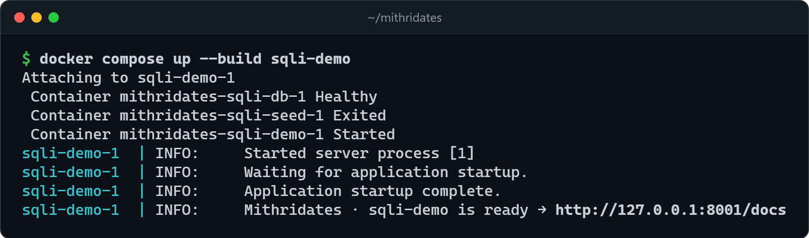
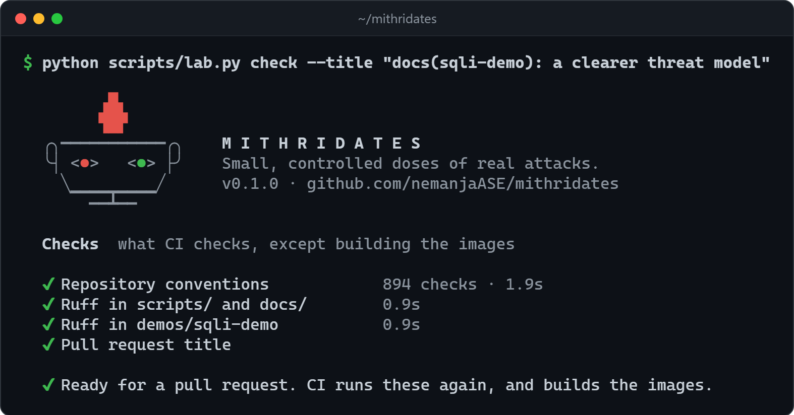

# Contributing

What this repository wants most is **more demos**: one attack, shown twice, vulnerable and
fixed. Improvements to the existing demos are just as welcome: a sharper payload, a
clearer figure, a defense that is missing a layer.

**Never contributed to an open-source project before?** This page assumes nothing. It walks
you from the fork to the merged pull request one command at a time, and says what to do
when something turns red. If you get stuck, open the pull request anyway and ask in it: an
unfinished draft is a good way to start the conversation.

Everyone taking part follows the [Code of Conduct](CODE_OF_CONDUCT.md). Contributions are
accepted under the [MIT license](LICENSE).

> [!IMPORTANT]
> **The ground rules in one line:** everything binds to `127.0.0.1`, nothing uses real
> credentials or real data, and nothing is aimed at someone else's systems.
> [The details](#ground-rules).

| You want to | Start here |
| --- | --- |
| Fix a typo, a sentence or a broken link | [A small fix, straight on GitHub](#a-small-fix-straight-on-github): nothing to install |
| Improve an existing demo | [Step by step](#your-first-contribution-step-by-step), skipping step 3 |
| Add a demo | [Step by step](#your-first-contribution-step-by-step), from the top |
| Report a problem, or propose a demo before building it | [Open an issue](https://github.com/nemanjaASE/mithridates/issues/new/choose) |
| Find something small to start with | [Issues labelled *good first issue*](https://github.com/nemanjaASE/mithridates/labels/good%20first%20issue) |

---

## Your first contribution, step by step

The commands below contain placeholders in angle brackets. Replace each one, brackets
included, with your own value, and type everything else exactly as it is written:

| Placeholder | What to put there | For example |
| --- | --- | --- |
| `<you>` | your GitHub username | |
| `<topic>` | your demo's short name, in lowercase; its folder becomes `demos/<topic>-demo` | `xss`, `ssrf`, `idor` |
| `<Attack name>` | the attack's full name | `Cross-site scripting` |
| `<summary>` | what your change does, in a few lowercase words | `reflected XSS on the search page` |

When you improve an existing demo instead of adding one, `<topic>` is that demo's: `sqli`
for `demos/sqli-demo`. The screenshots show example runs; yours will name your own demo.

### 0. What you need

| Tool | What it is for | Check that it works |
| --- | --- | --- |
| [Git](https://git-scm.com/downloads) | getting the code and sending your changes | `git --version` |
| [Docker Desktop](https://docs.docker.com/get-started/get-docker/), or Docker Engine with Compose v2.20 or newer | running the demos | `docker compose version` |
| [Python](https://www.python.org/downloads/) 3.11 or newer | the repository's scripts | `python --version` |
| [uv](https://docs.astral.sh/uv/getting-started/installation/) | the checks, and each demo's dependencies | `uv --version` |
| [Bruno](https://www.usebruno.com/downloads), optional | sending the attack and the defense requests | |
| A [GitHub account](https://github.com/signup) | your fork and the pull request | |

On Windows, run the commands below in **Git Bash**, which comes with Git, or in PowerShell 7.
On macOS and Linux, `python` may be called `python3`.

### 1. Fork and clone

Click **Fork** at the top of [the repository's page](https://github.com/nemanjaASE/mithridates).
GitHub makes your own copy, `github.com/<you>/mithridates`, which you are free to change.
Then download it:

```bash
git clone https://github.com/<you>/mithridates.git
cd mithridates
git remote add upstream https://github.com/nemanjaASE/mithridates.git
```

<details>
<summary>What a fork, a clone and <code>upstream</code> are</summary>

- A **fork** is your copy of the repository on GitHub. You cannot push to the original, so
  you push to your fork and ask for the change to be pulled in: that is a *pull request*.
- A **clone** is a copy of your fork on your own computer, where you do the work.
- **`upstream`** is a name for the original repository. Your clone already calls your fork
  `origin`; `upstream` lets it also fetch what others have merged in the meantime.

</details>

### 2. Create a branch

A branch keeps your change apart from `main`, so your fork's `main` stays a copy of the
original and you can work on more than one thing at a time:

```bash
git switch -c feat/<topic>-demo
```

| You are | Name the branch |
| --- | --- |
| adding a demo | `feat/<topic>-demo` |
| fixing something | `fix/<what>` |
| changing documentation | `docs/<what>` |

The name is only for you; nothing checks it.

### 3. Generate the demo

*Only for a new demo.* Check the idea against [what makes a good demo](#what-makes-a-good-demo),
then:

```bash
python scripts/new_demo.py <topic> --title "<Attack name>"
```

<p align="center">
  
</p>
<p align="center"><sub>An example run, for <code>xss</code> with <code>--postgres</code>.</sub></p>

The new demo already builds, runs and passes the checks: what is left is the attack itself.
`--postgres` adds a database, and `--mitigated` names the second variant for a defense that
only limits the damage. [All the options](#the-generator-in-detail).

### 4. Write the attack and the defense

Every place that waits for you is marked `TODO(attack)`: the generator listed the files.
To see the exact lines again:

```bash
git grep -n --untracked "TODO(attack)" -- demos/<topic>-demo docs/writeups README.md
```

Fill them in this order, so that each one gives you something to try. The paths are inside
`demos/<topic>-demo/`:

1. `app/infrastructure/feature/vulnerable.py`: the flaw;
2. `app/infrastructure/feature/safe.py` (`mitigated.py` with `--mitigated`): the defense,
   behind the same interface;
3. `app/api/routers.py`: the route's name;
4. `bruno/02-attack` and `bruno/03-defense`: the same payload, sent to both variants;
5. `docs/diagrams.py`: the four figures the README shows, [redrawn for your attack](#the-figures);
6. the demo's `README.md`; outside the demo folder, its write-up in `docs/writeups/` and its
   row in the root `README.md`;
7. with `--postgres`, the tables, in `app/infrastructure/seed.py`.

[The contract](#the-contract) lists what every demo has to provide.

#### The figures

The README shows the demo at the four levels of the C4 model, one figure each. The
generator drew them from its own code: `routers.py`, `RunFeatureUseCase`, the `Feature`
port and its two classes, and the database with `--postgres`. Redraw them for your attack
in the four functions at the end of `docs/diagrams.py`: `context()`, `containers()`,
`components()` and `code_level()`. Then draw them again, and check them:

```bash
python demos/<topic>-demo/docs/diagrams.py
python .claude/skills/house-style-figures/check_figures.py
```

The first command writes the four SVGs in `docs/`; open one in a browser to see it. The
second ends in `all passed` when no label overlaps a line or a box.
[`figure-kit.svg`](.claude/skills/house-style-figures/figure-kit.svg) shows every part with
the call that draws it. Two things to leave alone: the house-style block at the top of
`diagrams.py`, which the check compares with the original, and the SVGs themselves, which
the next run overwrites.

Would you rather draw in draw.io, Excalidraw or Mermaid? Delete `docs/diagrams.py` and put
your own images in `docs/`. The only rule is the C4 model: four levels, in order, each with
a figure.

### 5. Run it and try the attack

```bash
cd demos/<topic>-demo
docker compose up --build
```

When the service is ready, its log says where to open it:

<p align="center">
  
</p>
<p align="center"><sub>An example, for <code>sqli-demo</code>: yours names your demo and its port.</sub></p>

- **Swagger UI**, at that address, sends requests from the browser.
- **Bruno**: *Open Collection*, pick `demos/<topic>-demo/bruno`, and run the whole collection.
  With Node.js installed, the same from the terminal: `cd bruno && npx @usebruno/cli run -r`.
- **Stop it** with `Ctrl+C`, then `docker compose down`.

Change the code, run `docker compose up --build` again, and repeat until the attack works
on `vulnerable` and fails on the second variant.

### 6. Check it

One command runs what CI checks, apart from building the images:

```bash
python scripts/lab.py check --title "feat(<topic>-demo): <summary>"
```

<p align="center">
  
</p>
<p align="center"><sub>An example run, on a branch that changes <code>sqli-demo</code>.</sub></p>

It fails while a `TODO(attack)` marker is left, and names each one. `--title` checks the
title you are going to give the pull request. `feat` is the type for a new demo; for any
other change, pick the type from [the title format](#the-pull-request-title).

### 7. Commit and push

```bash
git add -A
git commit -m "feat(<topic>-demo): <summary>"
git push -u origin feat/<topic>-demo
```

Commit as often as you like, with any message: the pull request is squash-merged, so only
its title ends up on `main`. With a single commit, GitHub suggests that commit's message
as the title, so writing it in the title format saves you a step.

### 8. Open the pull request

1. Open your fork on GitHub. A bar offers **Compare & pull request**: click it. The base
   is `nemanjaASE/mithridates`, branch `main`; the other side is your branch.
2. **Title**: the one you checked in step 6.
3. **Description**: a few sentences under *What this changes*. Tick the checklist items
   that apply, and **delete** the ones that do not: an unticked box fails the check.
4. **Create pull request**, or **Create draft pull request** if it is not finished and you
   would like feedback first.

The checks start at once and take a few minutes. Each one ends with ✔ or ✘ and a
**Details** link to its log. A red check is a to-do, not a verdict: open Details, fix what
it says, then commit and push to the same branch. The pull request updates itself.

A maintainer then reviews it. Answer the comments, or push changes, the same way. Once it
is approved, the maintainer squash-merges it.

### 9. After the merge

Bring your fork up to date and clean up:

```bash
git switch main
git pull upstream main
git push origin main
git branch -D feat/<topic>-demo
python scripts/lab.py clean
```

The branch is deleted with `-D` because a squash merge makes a new commit, so git does not
see the branch as merged. `lab.py clean` stops the demos and removes the images you no
longer need.

---

## A small fix, straight on GitHub

For a typo or a sentence there is nothing to install:

1. Open the file on GitHub and click the pencil, **Edit this file**. GitHub makes the fork
   for you.
2. Make the change, then **Commit changes…** and **Propose changes**. GitHub makes the
   branch.
3. Give the pull request a title in the form `docs: <summary>`, or
   `docs(<topic>-demo): <summary>` when the change is inside one demo, and
   **Create pull request**.

The same checks run as for any other pull request.

---

## When something goes wrong

| What you see | What to do |
| --- | --- |
| **Pull request format** is red | The title or the description; Details says which. Edit them on the pull request page, and the check runs again by itself |
| **Conventions** or **Lint** is red | Run `python scripts/lab.py check`: it prints the same problems, each with its file |
| **Build** is red | Run `docker compose build` in the demo's folder and read the first error |
| *This branch has conflicts* | Someone merged first and you both changed the same lines, usually a row in `README.md`. See below |
| `Cannot connect to the Docker daemon` | Docker is installed but not running: start Docker Desktop |
| `port is already allocated` | Another program, or another demo, has the port: `python scripts/lab.py status` shows what is running |
| `uv: command not found` | Install [uv](https://docs.astral.sh/uv/getting-started/installation/), then open a new terminal |
| Anything else | Ask in the pull request, or [open an issue](https://github.com/nemanjaASE/mithridates/issues/new/choose), with the command and what it printed |

**Resolving a conflict.** Bring in what was merged meanwhile:

```bash
git fetch upstream
git merge upstream/main
```

Git marks each conflict with `<<<<<<<`, `=======` and `>>>>>>>`. Keep both versions (in a
table, both rows), delete the markers, then:

```bash
git add -A
git commit -m "merge main"
git push
```

If the other demo took the same port, `lab.py check` says so: give yours the next free
one, in `compose.yaml` and in its `PUBLIC_URL`.

---

**Reference.** The rest of this page is what the steps link to: what a demo has to be, how
it is laid out, and what CI checks.

---

## What makes a good demo

- **One attack**, with a cause you can point at in a single file.
- **A defense that lives in one place.** If defending it means rewriting half the service,
  the lesson gets lost; look for a smaller feature to attack.
- **Visible consequences.** "The query returned a row" teaches nothing; "the token now
  belongs to the admin" teaches the impact. Give the reader a way to see what the attacker
  actually got.
- **Runs on a laptop, offline.** No paid services, no accounts to create, no cloud
  credentials. A demo that needs a model runs one locally, on CPU.

Good candidates: web and API flaws, authentication and session handling, access control,
file handling, deserialization, SSRF, container and supply-chain weaknesses, and attacks on
AI applications.

---

## Ground rules

This repository contains deliberately vulnerable code for teaching. Keep it that way:

- Demos are for **local, isolated** use. Bind to `127.0.0.1`, never `0.0.0.0` on the host.
- No real credentials, no real customer data, and no payloads aimed at someone else's
  systems. Use obviously fictional accounts, as the existing demos do.
- Nothing that is only useful for attacking third parties: no scanners pointed at live
  hosts, no stolen data, no working exploits for unpatched software in the wild. The
  subject is the vulnerable code in this repository, and how to fix it.

---

## The generator in detail

```bash
python scripts/new_demo.py <topic> --title "<Attack name>" [--mitigated] [--postgres]
```

This creates `demos/<topic>-demo/` with everything a demo shares:

- a compose file and a Dockerfile, already hardened;
- a layered FastAPI application with login, error handling and security headers;
- the Bruno folders, the README, and C4 figures of the generated code, to redraw for your attack.

It also starts the write-up in `docs/writeups/`, picks the next number and port, and lists
the demo in `docker-compose.yml`, `README.md` and `docs/README.md`.

| Option | What it does |
| --- | --- |
| `--title` | the attack's name; the write-up's file name is made from it |
| `--mitigated` | names the second variant `mitigated` instead of `safe` (see [names and numbers](#names-and-numbers)) |
| `--postgres` | adds a database, a read-only application account and a seed job |
| `--port` | a port other than the next free one |

What is left for you is marked `TODO(attack)`, in the files
[step 4](#4-write-the-attack-and-the-defense) lists. `scripts/check_repo.py`, which
`lab.py check` runs, fails while any marker is left, and names every one of them:

<p align="center">
  
</p>

After a trial run, `python scripts/lab.py clean` stops the demo and removes its image
once its folder is gone.

The generator is a starting point, not a rule. A demo may change its structure, or leave
Python altogether; [the contract](#the-contract) is what counts.

---

## Names and numbers

Every demo owns a number, a port and an environment prefix. The generator picks the next
free ones; without it, look at what exists and take the next.

| | Rule | The existing demos |
| --- | --- | --- |
| **Number** | the next write-up number | `01`, `02` |
| **Port** | the next free port on the host | `8001`, `8002` |
| **`.env` prefix** | the topic in capitals | `SQLI_`, `PROMPTINJ_` |
| **Folder** | `demos/<topic>-demo/` | `demos/sqli-demo/` |
| **Image** | `mithridates/<topic>-demo:local` | `mithridates/sqli-demo:local` |
| **Containers** | `<topic>-demo`, `<topic>-db`, `<topic>-seed` | `sqli-demo`, `sqli-db`, `sqli-seed` |

**Name the second variant for what it is.** The route is `/api/v1/{vulnerable|safe}/…`
when the defense removes the cause, and `/api/v1/{vulnerable|mitigated}/…` when it only
limits the damage. `sqli-demo` is `safe`, because parameterization makes the attack
impossible; `promptinj-demo` is `mitigated`, because a hijacked model is still a hijacked
model. Choosing the honest word is part of the lesson.

---

## The layout

```
demos/<topic>-demo/
├── compose.yaml          # the whole demo: the application, and its database if it has one
├── .env.example          # every variable compose.yaml reads, commented out
├── Dockerfile
├── pyproject.toml        # and uv.lock
├── <package>/            # or src/<package>/; either layout works, be consistent
├── bruno/                # the guided request collection
└── docs/                 # the figures the README shows
```

Outside the demo's folder, a contribution touches only these:

```
docker-compose.yml           # one line: - demos/<topic>-demo/compose.yaml
README.md                    # one row in the table of demos
docs/
├── README.md                # one row in the table of write-ups
├── writeups/NN-<topic>.md   # yours: the write-up
├── templates/               # writeup.md and demo-readme.md: copied, never edited for one demo
└── assets/                  # the repository's logo, banner and icons
```

Both existing demos are worth reading. `sqli-demo` is the smaller one: a flat package, raw
SQL, no ORM.

---

## The contract

What every demo provides, so that any two of them can be read side by side.

### Two variants, one interface

The vulnerable and the fixed implementation are interchangeable: the same interface, the
same caller, selected in the path. Both implement one port, and the composition root wires
both:

```python
authenticators = {
    Variant.VULNERABLE: VulnerableSqlAuthenticator(legacy_db),
    Variant.SAFE: SafeSqlAuthenticator(app_db),
}
```

If switching the variant changes anything besides the one thing under study, the demo is
not making its point. A reader should be able to diff the two adapters and see the whole
difference.

### Running

- `docker compose up --build <topic>-demo` is the only command needed. Nothing has to be
  installed or configured on the host first, and nothing is a separate setup step.
- Every container built from the repository is hardened with the `x-hardening` anchor:
  non-root, `read_only`, `cap_drop: [ALL]`, `no-new-privileges`.
- A demo needs a database only when its attack does. When it has one:
  - a **one-off seed job** owns the admin credentials and loads the schema and the data.
    The application never receives them, and does not start until the seed job has
    finished (`condition: service_completed_successfully`);
  - the data lives in `tmpfs`, so every start begins from the same state and `down` leaves
    nothing behind;
  - the database sits on an `internal` network, with no port published to the host.

### HTTP

- Every route is prefixed with `/api/v1`.
- Every failure has one shape: a generic message, plus an `error_id` that joins the
  response to the server log. Submitted input is never echoed back (a `422` that reflects
  the password is a bug), and the database's or the model's own message never reaches the
  client.
- Routes use `fastapi.status` constants and declare the status codes they can return, so
  the Swagger page is accurate.
- Tokens use the OAuth 2.0 response shape (`access_token`, `token_type`, `expires_in`), and
  an unknown user and a wrong password get the same `401`.

### Security around the lesson

The deliberately broken part is confined to one adapter and says so in its docstring.
Everything else is done properly, because a demo where everything is sloppy cannot show
what the one flaw costs:

- **Least privilege** for every database account. The vulnerable path may get the
  over-broad account if that is part of the lesson; the write-up then says so.
- **Secrets have no default value in code.** They are required environment variables,
  checked at startup, and a missing one stops the process. Compose supplies lab values.
- **An audit log** of security decisions, with input escaped before it is written
  (`sanitize_for_log`), so an attacker cannot forge a log line. Passwords and tokens are
  never logged.
- **Educational output behind a switch**, off by default. Showing the SQL or the prompt that
  was sent would be information disclosure in a real application.

### Verification

A [Bruno](https://www.usebruno.com/) collection in `bruno/`, with the folders every demo
uses:

| Folder | Contents |
| --- | --- |
| `00-environments` | the service is up, and the seeded data is what the demo claims |
| `01-auth` | an honest login, a rejected one, and who a token belongs to |
| `02-…`, `03-…` | the attack **succeeding**, and the **same** payloads failing |
| `04-hardening` | the controls around it: bad tokens, wrong methods, oversized input, headers |

`00`, `01` and `04` keep those names; `02` and `03` are named after the demo.
`sqli-demo` uses `02-attack` and `03-defense`: one feature, and the same payloads go to
both routes. `promptinj-demo` has two features, so it uses `02-assistant` and `03-agent`,
each with its own attack and defense. Either way, the reader sees the same input succeed on
one route and fail on the other.

Every request has a `docs` block that says what it proves, and an assertion, so the
collection runs end to end. Where the outcome is not deterministic, **assert on the
control, not on the output**: `promptinj-demo` checks the retrieval scope and the tool's
decision, never the model's wording.

There are no automated test suites in this repository; the Bruno collection is the
verification. Please raise it in an issue before adding one.

### Documentation

- **The write-up** in `docs/writeups/NN-<topic>.md`, from
  [`docs/templates/writeup.md`](docs/templates/writeup.md). Its classification table
  (OWASP Top 10, CWE, CVSS, CIA) belongs there, not in the service README.
- **The service README**, from [`docs/templates/demo-readme.md`](docs/templates/demo-readme.md).
  It fixes the sections and their order, which the check script enforces, and answers
  "how do I run this, and what should I try" with the real defaults from the code.
- **Figures** follow the **C4 model**: `## How it works` shows the demo at its four levels,
  context, containers, components and code, in that order, each with a figure. How you
  draw them is up to you: any tool, any style.
- Everything is written in **English**.

### Tooling

`pyproject.toml` carries the same `[tool.ruff]` and `[tool.mypy]` blocks as the existing
demos. Two lines change per demo: `known-first-party` takes your package name, and a
`src/` layout also needs `mypy_path = "src"`. `uv run ruff check .` must pass; mypy is
there for your editor, and CI does not gate on it.

**Python versions.** The demos run on Python 3.14: the newest release that has been out for
a year, so every library a demo needs ships wheels for it. Python has no long-term support
release; each one gets [five years](https://devguide.python.org/versions/) of fixes. Each
October, when the next release turns one, the demos move to it, and four lines change
together: the `FROM` line in the `Dockerfile`, `requires-python`, ruff's `target-version`
and mypy's `python_version`, followed by `uv lock`. The scripts in `scripts/` run on your own
Python instead, so they support every release that still gets security fixes: 3.11 and
newer, until 3.11 reaches its end of life in October 2027. `OLDEST_PYTHON` in
`scripts/terminal.py` and in `ci.yml`, and `target-version` in `.ruff.toml`, hold them to it.

---

## Continuous integration

Every pull request runs [`ci.yml`](.github/workflows/ci.yml) and
[`pull-request.yml`](.github/workflows/pull-request.yml):

| Check | What it verifies |
| --- | --- |
| **Conventions** | `scripts/check_repo.py`: the files a demo provides, the Bruno folders, the README sections and their order, the four C4 levels, that every published port is bound to `127.0.0.1` and belongs to its demo, that every container built from the repository is hardened, that no secret has a default value in code, that `.env.example` names exactly the variables `compose.yaml` reads, that no `TODO(attack)` marker is left, and that no document links to a missing path |
| **Lint** | `uv run ruff check .` in each demo. The list is read from the folder names, so a new demo is covered without editing the workflow |
| **Build** | the compose files resolve, and every image builds |
| **Demo generator** | `scripts/new_demo.py` generates one demo of each kind, on Python 3.11, the oldest the scripts support; each must follow the contract, lint and build, and `check_repo.py` must catch the markers left in them |
| **Pull request format** | `scripts/check_pr.py`: the title is in the [expected form](#the-pull-request-title), `## What this changes` says what changes, and no checklist item is left unticked. It runs again when you edit the title or the description |

Run them yourself before you push, all but the builds, with one command:

```bash
python scripts/lab.py check
```

CI does not start a demo: the LLM demo alone downloads gigabytes. Starting a stack is
[a manual job](.github/workflows/smoke.yml), and your own `docker compose up` is what the
checklist asks for. Nothing is published or deployed from this repository.

---

## The pull request title

Pull requests are squash-merged, so the title becomes the commit on `main`. It follows
[Conventional Commits](https://www.conventionalcommits.org): `type(scope): description`.

| Type | When |
| --- | --- |
| `feat` | a new demo, or something a demo can show that it could not before |
| `fix` | something that does not work as documented. The vulnerable variant's flaw is the lesson, not a bug |
| `docs` | READMEs, write-ups and this file, with no change to code |
| `test` | the Bruno collections |
| `refactor` | code restructured without changing what it does |
| `style` | formatting only |
| `perf` | the same behaviour, faster |
| `build` | Dockerfiles, compose files, dependencies |
| `ci` | `.github/` and `scripts/` |
| `chore` | anything else |
| `revert` | undoes an earlier change. The title GitHub's **Revert** button writes is accepted as it is |

The scope is optional. When there is one, it is a demo's folder name (`sqli-demo`), or
`deps`, `scripts` or `house-style`. A `!` before the colon marks a change that breaks how a
demo is run or called: a route, a port, a variable. The description starts in lowercase,
has no full stop, and the whole title fits in 72 characters. Some examples:

```text
feat(xss-demo): reflected XSS on the search page
docs(sqli-demo): name both database accounts in the write-up
fix(sqli-demo)!: the login route moves to /api/v2
ci(deps): bump actions/checkout from 7.0.1 to 7.1.0
```

Check yours before you open the pull request:

```bash
python scripts/lab.py check --title "<type>(<scope>): <summary>"
```

---

## Before you open a pull request

- [ ] `docker compose up --build <topic>-demo` works from a clean checkout, and
      `docker compose down` leaves nothing behind.
- [ ] The attack works on the vulnerable route and fails on the fixed one, and the Bruno
      collection proves both with the same payload.
- [ ] `python scripts/lab.py check` passes.
- [ ] Every default in the README matches the code, and every path and identifier the
      documents name exists.
- [ ] The write-up says whether the attack has a real **fix** or only **mitigations**, and
      what the demo deliberately leaves out.
- [ ] No secret has a default value in code, and nothing is published to the host but the
      application's own port.
- [ ] The demo is listed in the root `docker-compose.yml`, in the table of demos in
      [`README.md`](README.md), and in [`docs/README.md`](docs/README.md). The generator
      adds all three; the row in `README.md` still needs its two descriptions.
