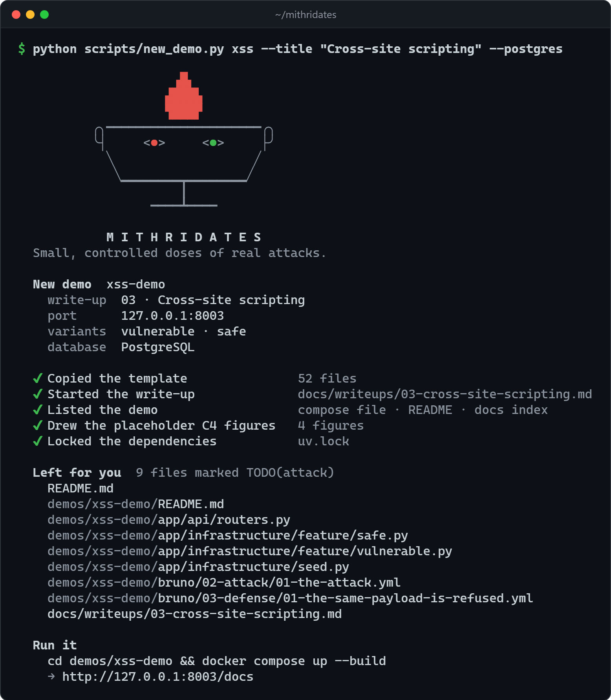
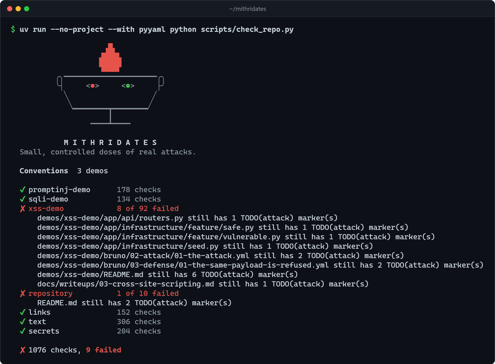

# Contributing

What this repository wants most is **more demos**: one attack, shown twice, vulnerable and
fixed. Improvements to the existing demos are just as welcome, and need none of the steps
below: a sharper payload, a clearer figure, a defense that is missing a layer.

Adding a demo never means editing another one. You add a folder, and the repository lists
it in three places.

Everyone taking part follows the [Code of Conduct](CODE_OF_CONDUCT.md). Contributions are
accepted under the [MIT license](LICENSE).

**From idea to pull request:**

1. **Check the idea** against [what makes a good demo](#what-makes-a-good-demo) and the
   [ground rules](#ground-rules). Opening a *Propose a demo* issue first is optional, but
   it saves you from building something someone else is already working on.
2. **Generate the demo** with [one command](#start-from-the-generator). It runs and passes
   the checks before the attack is written.
3. **Write the attack and the defense** wherever the generated files say `TODO(attack)`,
   following [the contract](#the-contract).
4. **Verify it**: `docker compose up`, the Bruno collection, and `check_repo.py`.
5. **Open the pull request** with a [title in the expected form](#the-pull-request-title)
   and the [checklist](#before-you-open-a-pull-request) ticked.

---

## What makes a good demo

- **One attack**, with a cause you can point at in a single file.
- **A defense that lives in one place.** If defending it means rewriting half the service,
  the lesson gets lost; look for a smaller feature to attack.
- **Visible consequences.** "The query returned a row" teaches nothing; "the token now
  belongs to the admin" teaches the impact. Give the reader a way to see what the attacker
  actually got.
- **Runs on a laptop, offline.** No paid services, no accounts to create, no cloud
  credentials. A demo that needs a model runs one locally, on CPU.

Good candidates: web and API flaws, authentication and session handling, access control,
file handling, deserialization, SSRF, container and supply-chain weaknesses, and attacks on
AI applications.

---

## Ground rules

This repository contains deliberately vulnerable code for teaching. Keep it that way:

- Demos are for **local, isolated** use. Bind to `127.0.0.1`, never `0.0.0.0` on the host.
- No real credentials, no real customer data, and no payloads aimed at someone else's
  systems. Use obviously fictional accounts, as the existing demos do.
- Nothing that is only useful for attacking third parties: no scanners pointed at live
  hosts, no stolen data, no working exploits for unpatched software in the wild. The
  subject is the vulnerable code in this repository, and how to fix it.

---

## Start from the generator

```bash
python scripts/new_demo.py <topic> --title "<Attack name>" [--mitigated] [--postgres]
```

This creates `demos/<topic>-demo/` with everything a demo shares:

- a compose file and a Dockerfile, already hardened;
- a layered FastAPI application with login, error handling and security headers;
- the Bruno folders, the README and placeholder C4 figures.

It also starts the write-up in `docs/writeups/`, picks the next number and port, and lists
the demo in `docker-compose.yml`, `README.md` and `docs/README.md`.

| Option | What it does |
| --- | --- |
| `--title` | the attack's name; the write-up's file name is made from it |
| `--mitigated` | names the second variant `mitigated` instead of `safe` (see [names and numbers](#names-and-numbers)) |
| `--postgres` | adds a database, a read-only application account and a seed job |
| `--port` | a port other than the next free one |

It prints each step as it runs, then the files left for you and the command that starts
the demo:

<p align="center">
  
</p>

What is left for you is marked `TODO(attack)`:

- the two implementations, in `app/infrastructure/feature/`;
- the route name, in `app/api/routers.py`;
- the payloads, in `bruno/02-attack` and `bruno/03-defense`;
- the text of the README and the write-up, and the demo's row in the root README;
- with `--postgres`, the tables, in `app/infrastructure/seed.py`.

`scripts/check_repo.py` fails while any marker is left, and names every one of them:

<p align="center">
  
</p>

After a trial run, `python scripts/lab.py clean` stops the demo and removes its image
once its folder is gone.

The generator is a starting point, not a rule. A demo may change its structure, or leave
Python altogether; [the contract](#the-contract) is what counts.

---

## Names and numbers

Every demo owns a number, a port and an environment prefix. The generator picks the next
free ones; without it, look at what exists and take the next.

| | Rule | The existing demos |
| --- | --- | --- |
| **Number** | the next write-up number | `01`, `02` |
| **Port** | the next free port on the host | `8001`, `8002` |
| **`.env` prefix** | the topic in capitals | `SQLI_`, `PROMPTINJ_` |
| **Folder** | `demos/<topic>-demo/` | `demos/sqli-demo/` |
| **Image** | `mithridates/<topic>-demo:local` | `mithridates/sqli-demo:local` |
| **Containers** | `<topic>-demo`, `<topic>-db`, `<topic>-seed` | `sqli-demo`, `sqli-db`, `sqli-seed` |

**Name the second variant for what it is.** The route is `/api/v1/{vulnerable|safe}/…`
when the defense removes the cause, and `/api/v1/{vulnerable|mitigated}/…` when it only
limits the damage. `sqli-demo` is `safe`, because parameterization makes the attack
impossible; `promptinj-demo` is `mitigated`, because a hijacked model is still a hijacked
model. Choosing the honest word is part of the lesson.

---

## The layout

```
demos/<topic>-demo/
├── compose.yaml          # the whole demo: the application, and its database if it has one
├── .env.example          # every variable compose.yaml reads, commented out
├── Dockerfile
├── pyproject.toml        # and uv.lock
├── <package>/            # or src/<package>/; either layout works, be consistent
├── bruno/                # the guided request collection
└── docs/                 # the figures the README shows
```

Outside the demo's folder, a contribution touches only these:

```
docker-compose.yml           # one line: - demos/<topic>-demo/compose.yaml
README.md                    # one row in the table of demos
docs/
├── README.md                # one row in the table of write-ups
├── writeups/NN-<topic>.md   # yours: the write-up
├── templates/               # writeup.md and demo-readme.md: copied, never edited for one demo
└── assets/                  # the repository's logo, banner and icons
```

Both existing demos are worth reading. `sqli-demo` is the smaller one: a flat package, raw
SQL, no ORM.

---

## The contract

What every demo provides, so that any two of them can be read side by side.

### Two variants, one interface

The vulnerable and the fixed implementation are interchangeable: the same interface, the
same caller, selected in the path. Both implement one port, and the composition root wires
both:

```python
authenticators = {
    Variant.VULNERABLE: VulnerableSqlAuthenticator(legacy_db),
    Variant.SAFE: SafeSqlAuthenticator(app_db),
}
```

If switching the variant changes anything besides the one thing under study, the demo is
not making its point. A reader should be able to diff the two adapters and see the whole
difference.

### Running

- `docker compose up --build <topic>-demo` is the only command needed. Nothing has to be
  installed or configured on the host first, and nothing is a separate setup step.
- Every container built from the repository is hardened with the `x-hardening` anchor:
  non-root, `read_only`, `cap_drop: [ALL]`, `no-new-privileges`.
- A demo needs a database only when its attack does. When it has one:
  - a **one-off seed job** owns the admin credentials and loads the schema and the data.
    The application never receives them, and does not start until the seed job has
    finished (`condition: service_completed_successfully`);
  - the data lives in `tmpfs`, so every start begins from the same state and `down` leaves
    nothing behind;
  - the database sits on an `internal` network, with no port published to the host.

### HTTP

- Every route is prefixed with `/api/v1`.
- Every failure has one shape: a generic message, plus an `error_id` that joins the
  response to the server log. Submitted input is never echoed back (a `422` that reflects
  the password is a bug), and the database's or the model's own message never reaches the
  client.
- Routes use `fastapi.status` constants and declare the status codes they can return, so
  the Swagger page is accurate.
- Tokens use the OAuth 2.0 response shape (`access_token`, `token_type`, `expires_in`), and
  an unknown user and a wrong password get the same `401`.

### Security around the lesson

The deliberately broken part is confined to one adapter and says so in its docstring.
Everything else is done properly, because a demo where everything is sloppy cannot show
what the one flaw costs:

- **Least privilege** for every database account. The vulnerable path may get the
  over-broad account if that is part of the lesson; the write-up then says so.
- **Secrets have no default value in code.** They are required environment variables,
  checked at startup, and a missing one stops the process. Compose supplies lab values.
- **An audit log** of security decisions, with input escaped before it is written
  (`sanitize_for_log`), so an attacker cannot forge a log line. Passwords and tokens are
  never logged.
- **Educational output behind a switch**, off by default. Showing the SQL or the prompt that
  was sent would be information disclosure in a real application.

### Verification

A [Bruno](https://www.usebruno.com/) collection in `bruno/`, with the folders every demo
uses:

| Folder | Contents |
| --- | --- |
| `00-environments` | the service is up, and the seeded data is what the demo claims |
| `01-auth` | an honest login, a rejected one, and who a token belongs to |
| `02-…`, `03-…` | the attack **succeeding**, and the **same** payloads failing |
| `04-hardening` | the controls around it: bad tokens, wrong methods, oversized input, headers |

`00`, `01` and `04` keep those names; `02` and `03` are named after the demo.
`sqli-demo` uses `02-attack` and `03-defense`: one feature, and the same payloads go to
both routes. `promptinj-demo` has two features, so it uses `02-assistant` and `03-agent`,
each with its own attack and defense. Either way, the reader sees the same input succeed on
one route and fail on the other.

Every request has a `docs` block that says what it proves, and an assertion, so the
collection runs end to end. Where the outcome is not deterministic, **assert on the
control, not on the output**: `promptinj-demo` checks the retrieval scope and the tool's
decision, never the model's wording.

There are no automated test suites in this repository; the Bruno collection is the
verification. Please raise it in an issue before adding one.

### Documentation

- **The write-up** in `docs/writeups/NN-<topic>.md`, from
  [`docs/templates/writeup.md`](docs/templates/writeup.md). Its classification table
  (OWASP Top 10, CWE, CVSS, CIA) belongs there, not in the service README.
- **The service README**, from [`docs/templates/demo-readme.md`](docs/templates/demo-readme.md).
  It fixes the sections and their order, which the check script enforces, and answers
  "how do I run this, and what should I try" with the real defaults from the code.
- **Figures** follow the **C4 model**: `## How it works` shows the demo at its four levels,
  context, containers, components and code, in that order, each with a figure. How you
  draw them is up to you: any tool, any style.
- Everything is written in **English**.

### Tooling

`pyproject.toml` carries the same `[tool.ruff]` and `[tool.mypy]` blocks as the existing
demos. Two lines change per demo: `known-first-party` takes your package name, and a
`src/` layout also needs `mypy_path = "src"`. `uv run ruff check .` must pass; mypy is
there for your editor, and CI does not gate on it.

---

## Continuous integration

Every pull request runs [`ci.yml`](.github/workflows/ci.yml) and
[`pull-request.yml`](.github/workflows/pull-request.yml):

| Check | What it verifies |
| --- | --- |
| **Conventions** | `scripts/check_repo.py`: the files a demo provides, the Bruno folders, the README sections and their order, the four C4 levels, that every published port is bound to `127.0.0.1` and belongs to its demo, that every container built from the repository is hardened, that no secret has a default value in code, that `.env.example` names exactly the variables `compose.yaml` reads, that no `TODO(attack)` marker is left, and that no document links to a missing path |
| **Lint** | `uv run ruff check .` in each demo. The list is read from the folder names, so a new demo is covered without editing the workflow |
| **Build** | the compose files resolve, and every image builds |
| **Demo generator** | `scripts/new_demo.py` generates one demo of each kind; each must follow the contract, lint and build, and `check_repo.py` must catch the markers left in them |
| **Pull request format** | `scripts/check_pr.py`: the title is in the [expected form](#the-pull-request-title), `## What this changes` says what changes, and no checklist item is left unticked. It runs again when you edit the title or the description |

Run the conventions yourself before you push:

```bash
uv run --no-project --with pyyaml python scripts/check_repo.py
```

CI does not start a demo: the LLM demo alone downloads gigabytes. Starting a stack is
[a manual job](.github/workflows/smoke.yml), and your own `docker compose up` is what the
checklist asks for. Nothing is published or deployed from this repository.

---

## The pull request title

Pull requests are squash-merged, so the title becomes the commit on `main`. It follows
[Conventional Commits](https://www.conventionalcommits.org): `type(scope): description`.

| Type | When |
| --- | --- |
| `feat` | a new demo, or something a demo can show that it could not before |
| `fix` | something that does not work as documented. The vulnerable variant's flaw is the lesson, not a bug |
| `docs` | READMEs, write-ups and this file, with no change to code |
| `test` | the Bruno collections |
| `refactor` | code restructured without changing what it does |
| `style` | formatting only |
| `perf` | the same behaviour, faster |
| `build` | Dockerfiles, compose files, dependencies |
| `ci` | `.github/` and `scripts/` |
| `chore` | anything else |
| `revert` | undoes an earlier change. The title GitHub's **Revert** button writes is accepted as it is |

The scope is optional. When there is one, it is a demo's folder name (`sqli-demo`), or
`deps`, `scripts` or `house-style`. A `!` before the colon marks a change that breaks how a
demo is run or called: a route, a port, a variable. The description starts in lowercase,
has no full stop, and the whole title fits in 72 characters:

```text
feat(xss-demo): reflected XSS on the search page
docs(sqli-demo): name both database accounts in the write-up
fix(sqli-demo)!: the login route moves to /api/v2
ci(deps): bump actions/checkout from 7.0.1 to 7.1.0
```

Check a title before you open the pull request:

```bash
python scripts/check_pr.py "feat(xss-demo): reflected XSS on the search page"
```

---

## Before you open a pull request

- [ ] `docker compose up --build <topic>-demo` works from a clean checkout, and
      `docker compose down` leaves nothing behind.
- [ ] The attack works on the vulnerable route and fails on the fixed one, and the Bruno
      collection proves both with the same payload.
- [ ] `uv run ruff check .` passes, and so does
      `uv run --no-project --with pyyaml python scripts/check_repo.py`.
- [ ] Every default in the README matches the code, and every path and identifier the
      documents name exists.
- [ ] The write-up says whether the attack has a real **fix** or only **mitigations**, and
      what the demo deliberately leaves out.
- [ ] No secret has a default value in code, and nothing is published to the host but the
      application's own port.
- [ ] The demo is listed in the root `docker-compose.yml`, in the table of demos in
      [`README.md`](README.md), and in [`docs/README.md`](docs/README.md). The generator
      adds all three; the row in `README.md` still needs its two descriptions.
