<p align="center">
  
</p>

<h1 align="center">Mithridates</h1>

<p align="center"><b>Small, controlled doses of real attacks.</b></p>

<p align="center">
  
  
  
  
  
  
  
  
</p>

**Real attacks, in small doses.** Every demo here is a small service with a working exploit
and its fix, running side by side on your machine. Send the same payload to both: one
breaks, the other holds, and the code that made the difference is right there to read.

The name comes from Mithridates VI of Pontus, who took a little poison every day until none
could harm him.

---

## The idea

Each demo is a small service you can run on its own. It exposes the same feature in two
versions, one vulnerable and one fixed, behind the same interface — so you can send the
same payload to both and compare what comes back:

<p align="center">
  
</p>

Each demo also has a write-up: what the attack gets, why it works, how it is fixed, and
what the demo leaves out.

A vulnerability shown on its own teaches the exploit. Shown next to its fix, in code that
is otherwise identical, it teaches the cause.

---

## What is in here

| # | Demo | Port | The attack | The fix / mitigation |
|---|------|------|------------|----------------------|
| 01 | [**sqli-demo**](demos/sqli-demo/README.md) | `:8001` | Input concatenated into a SQL string: `admin'--` yields an admin token with no password, `UNION` lifts secrets out through the token claims | Parameterized queries — input *cannot* become SQL |
| 02 | [**promptinj-demo**](demos/promptinj-demo/README.md) | `:8002` | A question that overrides the verified identity, so the assistant discloses another account or calls a tool against it | Least privilege — what the model never sees, it cannot leak |
| 03 | *your demo* | `:8003` | — | [Add one](CONTRIBUTING.md) |

> **Not every attack has a real fix.** Some can be removed at the cause; for others the
> best available defense only lowers the odds and limits the damage. Each write-up says
> which kind it is documenting, because that changes how much the defense can be trusted.

---

## Requirements

Everything runs in containers, so the host needs very little.

<details>
<summary><b>What the host needs</b></summary>

| | |
| --- | --- |
| **Docker, with Compose v2.20 or newer** | The root `docker-compose.yml` uses `include`, which older Compose versions do not understand. Check with `docker compose version`. |
| **The Docker daemon actually running** | Not just the CLI installed — Docker Desktop started, or `dockerd` up. A stopped daemon shows as a connection error, not a missing command. |
| **Internet for the first build** | Base images, dependencies and any model are downloaded once. After that a demo runs offline. |
| **A free port per demo** | Each publishes one port on `127.0.0.1`; the table above lists them. `port is already allocated` means something else is on it. |
| **Disk space** | A few hundred MB for a plain demo. Several GB for one that runs a local model, counting both the model-server image and the weights — each demo's README gives its own figure. |

Nothing else: no Python, no database and no language runtime on the host. A demo that
needs one ships it in its own image. Linux, macOS and Windows all work.

Optional, and only for the things around a demo: `curl` and `jq` for the checks in the
READMEs, [Bruno](https://www.usebruno.com/) to run the request collections, and
[uv](https://docs.astral.sh/uv/) to run the linter outside a container.

</details>


---

## What you should know

No security background is needed: every demo explains its attack from the beginning. You
should be comfortable running commands in a terminal and reading short Python functions.
Everything else is introduced where it is used, and the tables below say where to read
more.

<details>
<summary><b>Where to learn each technology</b></summary>

**To run the demos**

| Topic | Where it is used | Where to learn it |
| --- | --- | --- |
| Docker and Compose | every demo starts with `docker compose up` | [Docker: Get started](https://docs.docker.com/learn/) · [Compose overview](https://docs.docker.com/compose/) |
| HTTP and JSON | every request, sent with Bruno or `curl` | [MDN: An overview of HTTP](https://developer.mozilla.org/en-US/docs/Web/HTTP/Guides/Overview) |
| Bruno | the guided request collections in each `bruno/` folder | [Bruno documentation](https://docs.usebruno.com/) |

**To follow the code**

| Topic | Where it is used | Where to learn it |
| --- | --- | --- |
| Python | both demos | [The Python Tutorial](https://docs.python.org/3/tutorial/) |
| FastAPI | the HTTP layer of both demos | [FastAPI tutorial](https://fastapi.tiangolo.com/tutorial/) |
| SQL and PostgreSQL | the queries in `sqli-demo` | [PostgreSQL tutorial](https://www.postgresql.org/docs/current/tutorial.html) |
| JSON Web Tokens | the token every login returns | [Introduction to JSON Web Tokens](https://www.jwt.io/introduction) |
| LLMs and RAG | how `promptinj-demo` builds an answer | [Prompt Engineering Guide: RAG](https://www.promptingguide.ai/techniques/rag) · [Ollama](https://github.com/ollama/ollama/blob/main/README.md) · [LangChain](https://docs.langchain.com/) |

**To go deeper on the attacks**

| Topic | Where to learn it |
| --- | --- |
| SQL injection | [PortSwigger Web Security Academy: SQL injection](https://portswigger.net/web-security/sql-injection) (free, with hands-on labs) |
| Attacks on LLM applications | [PortSwigger Web Security Academy: Web LLM attacks](https://portswigger.net/web-security/llm-attacks) |
| The wider picture | [OWASP Top 10](https://top10.owasp.org/2025/) · [OWASP Top 10 for LLM Applications](https://genai.owasp.org/llm-top-10/) |
| This lab's own analysis | the write-ups in [`docs/writeups/`](docs/writeups/), one per demo |

</details>


---

## Running a demo

With the requirements above in place, every demo is started the same way.

The root `docker-compose.yml` holds no services of its own — it only `include`s each
demo's compose file. Every demo names its main service after its folder, so the folder
name from the table above is also the command:

```bash
docker compose up --build <demo-name>   # one demo, with everything it depends on
docker compose up --build               # everything
docker compose down                     # stop everything
```

Naming one demo starts only that demo and the containers it depends on. Each one also
runs without the root file at all:

```bash
cd demos/<demo-name> && docker compose up --build
```

Swagger UI is at `/docs` on every service, and each demo's README states its port and
what the first start has to download — a demo that runs a local model pulls it once and
works offline afterwards.

**Cleaning up.** `docker compose down` stops a demo, but the images it built stay. To see
and remove what the lab leaves in Docker:

```bash
python scripts/lab.py status   # containers, images and model volumes, leftovers marked
python scripts/lab.py clean    # stop every demo, remove leftover images
```

`clean --all` also removes the demos' own images, `--models` the downloaded models, and
`--dry-run` prints what would be removed without removing it.

---

## What every demo has in common

The conventions below hold for every demo, which is what makes two of them worth reading
side by side. A new demo is expected to follow the same list, and
[**CONTRIBUTING.md**](CONTRIBUTING.md) goes through it point by point.

| | |
| --- | --- |
| **Two variants, one interface** | The vulnerable and the fixed implementation sit behind the same port/interface and are selected in the path (`/api/v1/{vulnerable\|safe}/…`). Switching variant must not change anything else. |
| **One command to run** | A `compose.yaml` in the demo's folder, plus one line in the root `docker-compose.yml`. Nothing to install or configure beforehand, and no separate step to set anything up: `docker compose up` does all of it. |
| **Starts from fixed data** | Every start is identical. A demo with a database loads it in a one-off seed job, which owns the admin credentials the application never gets, and keeps the data in `tmpfs`. |
| **An honest HTTP contract** | `/api/v1` prefix, one error shape (`ErrorOut`: a generic message plus an `error_id` that joins to the log), documented status codes, an OAuth 2.0-shaped token response. |
| **Hardened around the lesson** | The deliberately broken part is confined to one adapter. Everything else follows the guidelines: secrets required from the environment with no defaults in code, an audit log safe against log injection, non-root read-only containers, and, where there is a database, least-privilege accounts on an internal network. |
| **Educational output behind a switch** | Showing the SQL or the prompt that was sent is off by default — in a real application it would be information disclosure. |
| **A guided request collection** | A [Bruno](https://www.usebruno.com/) collection numbered `00`–`04`: stack check, login, the attack and its defense, hardening. Each request carries an explanation and an assertion. |
| **A write-up and a README** | An attack write-up in `docs/writeups/NN-name.md` from [`docs/templates/writeup.md`](docs/templates/writeup.md), and a service README from [`docs/templates/demo-readme.md`](docs/templates/demo-readme.md). |

---

## Technology

How a demo is packaged, verified and documented is fixed, because the repository is built
around those three. The language, the database and the libraries are the author's choice.

<details>
<summary><b>The stack, in detail</b></summary>

| | |
| --- | --- |
| **Packaging** | Docker with Compose v2.20+ |
| **Verification** | a [Bruno](https://www.usebruno.com/) collection in `bruno/`; for a Python demo also [Ruff](https://docs.astral.sh/ruff/) and mypy, configured as in an existing `pyproject.toml` |
| **Documentation** | the templates in [`docs/`](docs/README.md), written in English |
| **Language** | Python 3.13 with [uv](https://docs.astral.sh/uv/) in the current demos; a new one may use another |
| **Database** | PostgreSQL 18 here, with [pgvector](https://github.com/pgvector/pgvector) where the demo needs embeddings; a new demo uses whatever its attack calls for |
| **Libraries** | per demo, declared in its own `pyproject.toml` — FastAPI in both, and a local [Ollama](https://ollama.com/) model driven by LangChain in `promptinj-demo`, so the LLM demo runs on CPU with no API key |

</details>


Both demos follow the same architectural rule: dependencies point inward only
(HTTP layer → use cases → domain), and concrete classes are chosen in exactly one place,
`container.py`. The vulnerable and the safe variant implement the **same port** — which is
why the diff between them is small enough to read out loud.

---

## Documentation

| | |
| --- | --- |
| [`docs/`](docs/README.md) | attack write-ups, glossary, overview of the applied guidelines |
| [`docs/writeups/`](docs/writeups/) | the write-ups, one per demo — a new demo adds its own here |
| [`docs/templates/`](docs/templates/) | the templates a new demo copies: [`writeup.md`](docs/templates/writeup.md) · [`demo-readme.md`](docs/templates/demo-readme.md) |
| [`CONTRIBUTING.md`](CONTRIBUTING.md) · [`CODE_OF_CONDUCT.md`](CODE_OF_CONDUCT.md) | how to add a demo, and how everyone taking part is expected to behave |
| [`LICENSE`](LICENSE) · [`CITATION.cff`](CITATION.cff) | the MIT license, and how to cite the lab in teaching or research |
| [`demos/sqli-demo/.env.example`](demos/sqli-demo/.env.example) · [`demos/promptinj-demo/.env.example`](demos/promptinj-demo/.env.example) | what can be changed in each demo without touching code |

---

<p align="center">
  <sub>Built for teaching in an isolated local environment. The vulnerable code is confined
  to one adapter per demo; everything else follows the guidelines.</sub>
</p>
