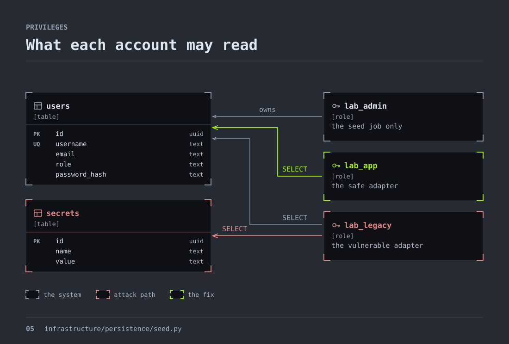

# sqli-demo

<p align="center">
  
  
  
  
  
  
</p>

<p align="center">
  <b>⚠️ This code is deliberately vulnerable.</b> The port binds to <code>127.0.0.1</code>. Do not expose it on a network.
</p>

---

## What this service does

A login endpoint of the kind every application has: a username, a password, and a token
in return. It is implemented twice, and the variant in the path decides which
implementation answers the request.

---

## Technology

| | |
| --- | --- |
| **Language** | Python 3.13, managed with [uv](https://docs.astral.sh/uv/) |
| **API** | FastAPI, Pydantic, PyJWT |
| **Database** | PostgreSQL 18, with every query written by hand through psycopg (the PostgreSQL driver for Python). There is no ORM on purpose: an ORM parameterises for you, and the one line this demo exists to show would never be written |
| **Packaging** | Docker Compose. The application runs as an ordinary user, cannot write to its own disk and has no root privileges; the database is the one exception |
| **Verification** | a [Bruno](https://www.usebruno.com/) collection in [`bruno/`](bruno/), plus [Ruff](https://docs.astral.sh/ruff/) and mypy |

---

## Running it

You need Docker with Compose.

```bash
cd demos/sqli-demo
docker compose up --build
```

Check that it works:

```bash
curl -s localhost:8001/ | jq
```

It should list the routes and `"swagger": "/docs"`. If nothing answers, the application is
still waiting for the seed job — `docker compose logs sqli-seed` has to end with
`Database reset and seeded.`

```bash
docker compose down
```

The database lives in `tmpfs`, so `down` wipes everything and every `up` starts from the
same data.

---

## The attack, step by step

Login is `POST /api/v1/{vulnerable|safe}/auth/login` with the body
`{"username": "...", "password": "..."}`. The password below is always `anything` — that
is the whole point.

| # | `username` | What happens on `vulnerable` |
| --- | --- | --- |
| 1 | `admin` (wrong password) | `401` — the baseline, this is what a normal rejection looks like |
| 2 | `admin'--` | **an admin token with no password** — `--` comments out the password check |
| 3 | `' OR '1'='1'--` | a token for the first row in the table (`mjovanovic`) — not even an existing name is needed |
| 4 | `' UNION SELECT id, name, value FROM secrets WHERE name = 'flag'--` | the token is issued for a "user" from `secrets`, so `role` becomes `FLAG{...}` |
| 5 | the same on `safe` | `401` for every payload from 2–4 |

What the attacker actually got is visible at `GET /api/v1/users/me` (header
`Authorization: Bearer <token>`) — the endpoint returns the token's owner.

To see the SQL that actually reached the database, restart with the query trace on. It
adds a `debug` field to the response:

```bash
EXPOSE_QUERY_TRACE=true docker compose up -d --build sqli-demo
```

`GET /api/v1/debug/users` lists what the database actually holds, so the rows the payloads
above returned can be checked against it. Turn it off with `ENABLE_DEBUG_ENDPOINTS=false`.

---

## How it works

**Level 1 — context.** Who drives the lab, and what it pulls from outside itself:


**Level 2 — containers.** What runs, what it is built on, and the one way in:


| Container | What it is | Job |
| --- | --- | --- |
| `sqli-demo` | `mithridates/sqli-demo:local` | the application; the only one visible from the host; **never gets the database superuser password** |
| `sqli-db` | `postgres:18-alpine` | the database; data in `tmpfs` |
| `sqli-seed` | the same image as the application | one-off: schema, data, privileges — the only holder of `lab_admin` |

The two containers built from this repository, `sqli-demo` and `sqli-seed`, are locked
down like this:

| Setting | What it means | What an attacker cannot do |
| --- | --- | --- |
| `appuser` (uid 10001) | the process runs as an ordinary user, not as root | be root inside the container |
| `read_only: true` | the container cannot write to its own filesystem | leave a file behind or change the code |
| `cap_drop: ALL` | every piece of root's power (a Linux *capability*) is removed | change who owns a file, or get past file permissions |
| `no-new-privileges` | a process can never gain more rights than it started with | climb to root through `sudo` or a similar program |

The database is the one exception. The official Postgres image starts as root to take
ownership of its data folder, then switches to the `postgres` user; for that first step it
keeps five capabilities (`CHOWN`, `DAC_OVERRIDE`, `FOWNER`, `SETGID`, `SETUID`). It is still
read-only, still cannot gain new privileges, and publishes no port.

**Level 3 — components.** What one request passes through inside the container:


> [!NOTE]
> **as SQL** — the vulnerable adapter puts the username into the text of the query with an
> f-string, so the database reads it as part of the SQL: `admin'--` closes the string and
> comments out the password check.
>
> **as a value** — the safe adapter sends the query with a `%s` placeholder and the username
> separately, so the database only ever compares it as data: `admin'--` is just a username
> that does not exist.

**Level 4 — code.** The port and the two classes that implement it:


The difference is **one adapter**:

| | `vulnerable` | `safe` |
| --- | --- | --- |
| **Class** | `VulnerableSqlAuthenticator` | `SafeSqlAuthenticator` |
| **The username** | pasted into the SQL text with an f-string | sent on its own, bound to `%s` |
| **The password** | pasted in too, so it sits in the statement in plain text | sent on its own; the statement never contains it |
| **Database account** | `lab_legacy`, which can read `secrets` | `lab_app`, which cannot |
| **`admin'--` gets** | `200` and an admin token | `401` |

Both check the password the same way, against a bcrypt hash with pgcrypto's `crypt()`.

---

## The database

Two tables and three roles. The grants are what decide **how much the attack is worth**,
even when it lands.



| Account | Used by | Privileges |
| --- | --- | --- |
| `lab_admin` | `sqli-seed` only | superuser |
| `lab_legacy` | the vulnerable adapters | `SELECT` on `users` and `secrets` — deliberately too much, which is why `UNION` reads the secrets |
| `lab_app` | the safe adapters | `SELECT` on only the columns it needs; cannot see `secrets` or `email` |

`lab_legacy` and `lab_app` — the two database accounts the application connects with —
are read-only, and every query they run is cut off after 5 seconds (`statement_timeout`).
So not even `'; DROP TABLE users;--` can change anything.

---

## Configuration

Compose sets the lab values. To change one, copy [`.env.example`](.env.example) to `.env`
in this folder and uncomment its line; it applies whether the demo is started here or from
the repository root.

| Variable | Default | What it does |
| --- | --- | --- |
| `DB_HOST`, `DB_NAME` | — (required) | the database; compose: `sqli-db`, `lab` |
| `DB_LEGACY_USER` / `_PASSWORD` | — (required) | the vulnerable adapters' account |
| `DB_APP_USER` / `_PASSWORD` | — (required) | the safe adapters' account |
| `DB_ADMIN_USER` / `_PASSWORD` | — (required, **seed only**) | superuser; the application never gets it |
| `JWT_SECRET` | — (required, ≥ 32 bytes) | token signing key; no default value in code |
| `JWT_TTL_SECONDS` | `900` | token lifetime |
| **`EXPOSE_QUERY_TRACE`** | `false` | adds `debug` with the executed SQL to the response |
| **`ENABLE_DEBUG_ENDPOINTS`** | `true` | enables `GET /api/v1/debug/users` |

The bold ones are educational switches — a real application would have them off.

### Accounts

| User | Role | Password |
| --- | --- | --- |
| `admin` | admin | `S3cr3tAdminPass!` |
| `mjovanovic` | user | `Leto2026!` |
| `spetrovic` | user | `Beograd#92` |
| `jkovac` | editor | `Urednik!7` |

The `secrets` table holds `flag` → `FLAG{sql_injection_demo}`, the target of the `UNION`
attack.

---

## Verification

[`bruno/`](bruno/) — 19 requests, each with an explanation and an assertion:

| Folder | What it proves |
| --- | --- |
| `00-environments` | the service is up and the database holds real data |
| `01-auth` | an honest login, a rejected login, and who owns the token |
| `02-attack` | all three payloads **succeed** against `vulnerable` |
| `03-defense` | the **same** payloads fail against `safe` |
| `04-hardening` | an `alg: none` token, the wrong method, oversized input, response headers |

Folders `02` and `03` send the same payload to two routes — that is the entire proof.

Static checks: `uv run ruff check .`

---

## Troubleshooting

| Symptom | Cause and what to do |
| --- | --- |
| `curl localhost:8001` does not answer | The application is waiting for the seed job: `docker compose logs sqli-seed`. |
| `503` with an `error_id` in the response | The database is unreachable. The message is generic on purpose; the cause is in the log under the same `error_id`. |
| `ConfigurationError: Missing required env variable` | Started outside compose. Secrets have no default value in code. |
| `admin'--` returns `401` | You are hitting the `safe` route. Check the path. |
| `port is already allocated` | Something is already listening on 8001; change the mapping in `compose.yaml`. |

---

The full story of the attack (flow, cause, defense): [`../../docs/writeups/01-sql-injection.md`](../../docs/writeups/01-sql-injection.md)
· Lab overview: [`../../README.md`](../../README.md)
