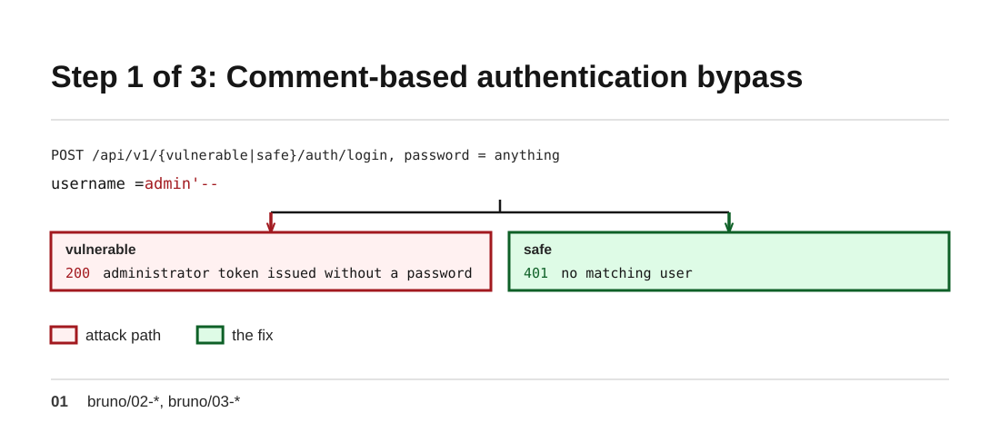
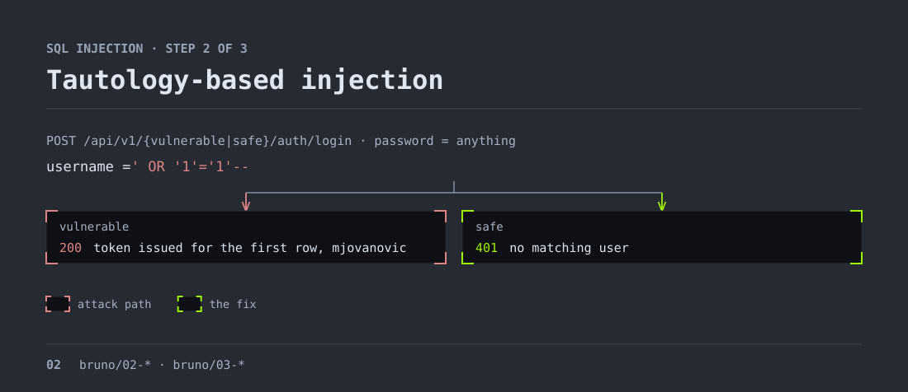
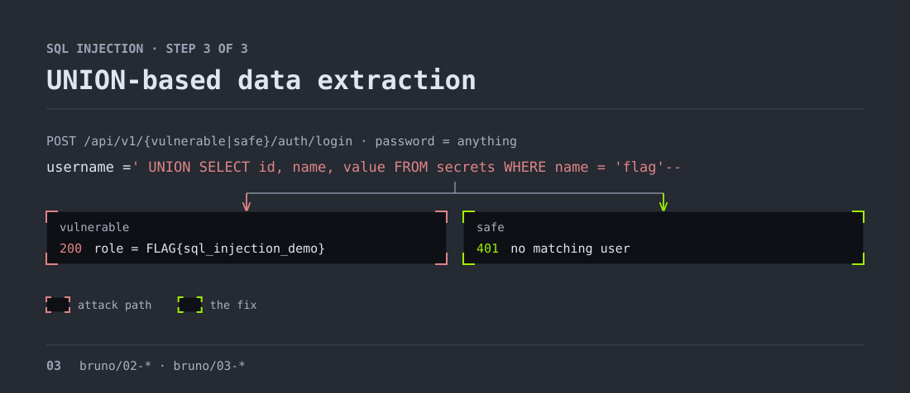

# 01 — SQL injection in a login endpoint

| | |
| --- | --- |
| **OWASP Top 10** | [A05:2025 – Injection](https://owasp.org/Top10/2025/) (A03 in the 2021 edition) |
| **CWE** | [CWE-89: SQL Injection](https://cwe.mitre.org/data/definitions/89.html) |
| **CVSS v4.0** | 9.3 Critical (illustrative) — [`CVSS:4.0/AV:N/AC:L/AT:N/PR:N/UI:N/VC:H/VI:H/VA:N/SC:N/SI:N/SA:N`](https://www.first.org/cvss/calculator/4.0#CVSS:4.0/AV:N/AC:L/AT:N/PR:N/UI:N/VC:H/VI:H/VA:N/SC:N/SI:N/SA:N): exploitable over the network without authentication |
| **CIA** | **Confidentiality**: any table readable by the database account, in this case `secrets`, via `UNION`. **Integrity**: authentication as any user, including the administrator |

## The attack

SQL injection occurs when user input is incorporated into the text of an SQL statement, so
that the database interprets part of that input as SQL rather than as data. In this demo
the affected input is the username of the login endpoint. The application concatenates it
into the authentication query, and the database has no means of distinguishing the
statement written by the developer from the characters supplied by the user.

Three payloads are demonstrated. `admin'--` authenticates as the administrator with an
arbitrary password. `' OR '1'='1'--` authenticates as the first user in the table. A
`UNION`-based payload returns a row of the `secrets` table, which the application then
places in the issued token. Against the `safe` route, each payload results in `401`. The
requests and responses are listed in the demo's README:
[The attack, step by step](../../demos/sqli-demo/README.md#the-attack-step-by-step).

Select a step to view the responses of both routes:

<details open>
<summary><b>Step 1 · Comment-based authentication bypass</b></summary>



</details>
<details>
<summary><b>Step 2 · Tautology-based injection</b></summary>



</details>
<details>
<summary><b>Step 3 · UNION-based data extraction</b></summary>



</details>

Outside the scope of this demo, the same flaw can allow data to be modified or deleted and,
in some database configurations, commands to be executed on the server. Here these outcomes
are prevented by the privileges of the database accounts (see **The fix**).

## Why it works


**Code and data share a single string.** `VulnerableSqlAuthenticator`
(`app/infrastructure/auth/vulnerable_sql_authenticator.py`) constructs the query by string
formatting:

```python
statement = (
    "SELECT id, username, role FROM users "
    f"WHERE username = '{username}' AND password_hash = crypt('{password}', password_hash)"
)
```

The password is verified within the same statement: the predicate
`password_hash = crypt(input, password_hash)` holds only for the correct password
(pgcrypto, bcrypt). For the username `admin'--`, the database receives:

```sql
SELECT id, username, role FROM users WHERE username = 'admin'--' AND password_hash = crypt('...', password_hash)
```

- The apostrophe terminates the string literal opened by the developer, and the remainder
  of the input is parsed as SQL.
- `--` begins a comment, so the rest of the line, including the password predicate, is
  not evaluated.

The executed query is therefore `SELECT id, username, role FROM users WHERE username =
'admin'`. The attacker does not need to know the password, because the condition that
verifies it has been removed from the statement. The payload `' OR '1'='1'--` follows the
same pattern with a condition that is always true, and the `UNION` payload appends a second
`SELECT` whose three columns, taken from `secrets`, are returned in place of a user record.

## The fix


**Parameterized queries.** `SafeSqlAuthenticator`
(`app/infrastructure/auth/safe_sql_authenticator.py`) passes user input to the database
separately from the statement:

```python
_AUTHENTICATE = (
    "SELECT id, username, role FROM users "
    "WHERE username = %s AND password_hash = crypt(%s, password_hash)"
)
conn.execute(_AUTHENTICATE, (username, password))
```

`%s` denotes a placeholder, not a text substitution. The database parses the statement,
whose structure is fixed, before the values are bound, and binds them strictly as data.
`admin'--` is therefore compared as an ordinary username that does not exist. Apart from
the placeholders, the statement is identical to the vulnerable one.

Since user input can no longer alter the structure of the query, the cause of the
vulnerability is removed. SQL injection therefore has a complete **fix**, whereas many
other attacks can only be mitigated.

The following controls limit the impact should another defect occur (defense in depth):

- **Least privilege in the database.** `lab_app`, the account of the safe variant, holds
  `SELECT` only on the columns of `users` it requires and has no access to `secrets` or
  `email`. Both application accounts, `lab_legacy` and `lab_app`, are read-only and subject
  to a `statement_timeout` (`app/infrastructure/persistence/seed.py`), so a payload such as
  `'; DROP TABLE users;--` cannot modify data.
- **Password storage.** Passwords are stored only as bcrypt hashes (pgcrypto `crypt()`
  with `gen_salt('bf')`), so reading the `users` table does not reveal usable passwords.
- **Error handling.** A failed query returns a generic message with an `error_id`. The
  database error is written only to the server log, which gives error-based injection no
  feedback.
- **Further measures.** Short-lived signed JWTs, a bounded input length and security
  headers. Rejecting apostrophes in the input is a supplementary measure and not a
  substitute for parameterization.

## What this demo does not cover

- Rate limiting and account lockout.
- Allow-list validation of input.
- Constant-time verification of the hash in the application, with a dummy hash for unknown
  usernames, which prevents account enumeration through response times.
- The `secrets` table exists only to provide a target for the `UNION` payload.

## References

- OWASP — [A05:2025 Injection](https://owasp.org/Top10/2025/) · [SQL Injection Prevention Cheat Sheet](https://cheatsheetseries.owasp.org/cheatsheets/SQL_Injection_Prevention_Cheat_Sheet.html)
- OWASP — [Authentication Cheat Sheet](https://cheatsheetseries.owasp.org/cheatsheets/Authentication_Cheat_Sheet.html) · [Password Storage Cheat Sheet](https://cheatsheetseries.owasp.org/cheatsheets/Password_Storage_Cheat_Sheet.html)
- MITRE — [CWE-89](https://cwe.mitre.org/data/definitions/89.html) · [ATT&CK T1190 – Exploit Public-Facing Application](https://attack.mitre.org/techniques/T1190/)
